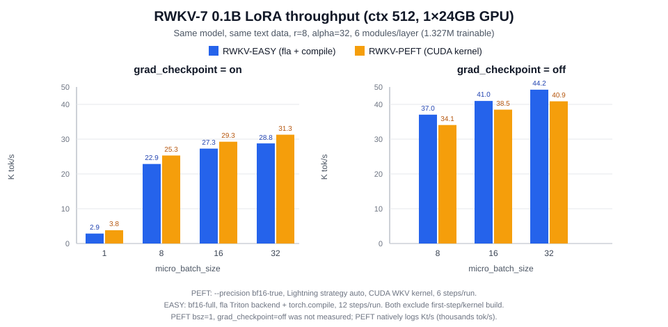

# RWKV-EASY

**RWKV-7 的一键式微调工具：只做 LoRA 和 State Tuning，两者都能叠加无限上下文（infctx）。**

[](CHANGELOG.md)
[](pyproject.toml)
[](LICENSE)
[](tests)

一条命令装好环境，在向导里按回车就能开始训练。数据用 ShareGPT，
只有 assistant 回复参与 loss；CPU / CUDA / ROCm / MPS 通用，
运行时只依赖 `torch` + `pyyaml`。

## 为什么用它

|  | RWKV-PEFT | RWKV-EASY |
|---|---|---|
| `infctx` + LoRA | ❌ 状态参数被 PEFT 当成 `attention_mask`，运行即报错 | ✅ 自研 LoRA，不改模型签名，天然兼容 |
| `infctx` + State Tuning | ❌ 两者在代码里强制互斥 | ✅ 可自由组合 |
| ShareGPT 数据 | ❌ 没有对话解析与 assistant-only mask | ✅ 原生支持，自动构造只训练回复的掩码 |
| 依赖 | transformers / peft / lightning / rwkv / triton … | 只需要 `torch` + `pyyaml` |

另外：三种 decay 公式（`clampw` / `softplus` / `exp`）自动校准，用错公式不会报错、
但输出会明显变差；`rwkv-fla` 融合内核在 CUDA 上可再快约 2 倍。

## 性能

0.1B（`rwkv7-g1d-0.1b`）/ 24GB Ampere 级单卡 / `bf16-full` 实测：

| 场景 | 配置 | 吞吐 | 显存 |
|---|---|---|---|
| **LoRA** | fla + compile，ctx512 / bsz32 | **48.5K tok/s** | 11.9 GiB |
| LoRA | native + compile，ctx512 / bsz24 | 24.3K tok/s | 16.9 GiB |
| **State** | fla + reduce-overhead，ctx512 / bsz32 | **56.3K tok/s** | 9.2 GiB |
| **LoRA + infctx** | fla + compile，ctx8K / chunk2048 / bsz2 | **37.0K tok/s** | 3.4 GiB |
| LoRA + infctx | fla + compile，ctx8K / chunk2048 / bsz10 | 41.7K tok/s | 15.2 GiB |
| LoRA + infctx | fla，ctx32K / chunk2048 / bsz2 | 33.6K tok/s | **3.4 GiB** |
| **State + infctx** | fla，ctx8K / chunk2048 / bsz2 | **72.6K tok/s** | 2.7 GiB |

- LoRA 48.5K ≈ **55.6 TFLOPS**，State 56.3K ≈ **64.5 TFLOPS**；设备 bf16 峰值
  62–74 TFLOPS，已用到 75–90%。
- infctx 每块立即反传，显存只与 `chunk_ctx` 有关：0.1B 在 24GB 卡上可训
  **32K 上下文（3.4 GiB）**。
- 不同 `ctx_len` / `chunk_ctx` / `bsz` 的 tok/s 不可直接比较；调优方法与
  换卡建议见 [`docs/PERFORMANCE.md`](docs/PERFORMANCE.md)。

与 RWKV-PEFT 同机、同权重、同 LoRA 配置（1.327M 可训练参数）对比：



- 关梯度检查点、bsz≥8：EASY 快 **6–9%**；双方最佳配置 **44.2K vs 40.9K**（bsz32）。
- 开梯度检查点：PEFT 快 7–34%（其 CUDA kernel 每步固定开销更小）。
- 完整表格与公平性说明见 [`docs/GPU_VERIFICATION.md`](docs/GPU_VERIFICATION.md#7-与-rwkv-peft-的-lora-对比)。

## 快速开始

### 一键（新手推荐）

```bash
python quickstart.py
```

Windows 双击 `quickstart.bat`，Linux/macOS 也可以 `bash quickstart.sh`。

它会自动检测 CUDA、创建 `.venv`、安装对应 PyTorch 与本项目，然后进入向导：
欢迎页可一键使用**推荐模板**，也可以按场景选长上下文 / State / 省显存 / 20 步试跑；
`←/→` 切换选项，`空格` 勾选 LoRA 模块与 block 层，每个参数右侧都有行内注释，
选中后还有详细说明，`g` 可打开 4 页新手引导。模型/数据路径自动校验。
详见 [`docs/WIZARD.md`](docs/WIZARD.md)。

### 手动四步

```bash
pip install -e .                                  # 1. 安装（只需 torch + pyyaml）

rwkv-easy init --model models/你的模型.pth \
               --data data/sharegpt.json --method lora   # 2. 生成配置

rwkv-easy inspect-data -c configs/my-lora-run.yaml        # 3. 确认 loss mask

rwkv-easy train -c configs/my-lora-run.yaml               # 4. 开始训练
```

训练结束会自动合并出 `runs/xxx/merged.pth`，可以直接试跑：

```bash
rwkv-easy generate -m runs/xxx/merged.pth -p "你好，请介绍一下自己" --max-tokens 64
rwkv-easy train -c configs/my-lora-run.yaml --resume runs/xxx   # 断点续训
```

模型用官方 state_dict 格式的 `.pth` / `.safetensors`，维度自动推断；数据支持
ShareGPT、OpenAI `messages`、两列指令和纯文本。完整流程（安装、数据检查、
输出文件、模型验收、CPU 自检、自我认知 demo）见
[`docs/GETTING_STARTED.md`](docs/GETTING_STARTED.md)。

## 四种训练组合

| 组合 | 配置 | 适合场景 |
|---|---|---|
| **LoRA** | `method: lora`、`infctx: false` | 常规指令微调，效果与稳定性最好 |
| **State Tuning** | `method: state`、`infctx: false` | 小数据快速适配，参数量 < 0.1% |
| **LoRA + infctx** | `method: lora`、`infctx: true` | 长对话 / 长文档，显存只与 `chunk_ctx` 有关 |
| **State + infctx** | `method: state`、`infctx: true` | 长上下文 + 极小参数适配 |

模板在 `configs/`：`lora_sharegpt.yaml`、`lora_sharegpt_fla.yaml`（最快）、
`state_sharegpt.yaml`、`lora_sharegpt_infctx.yaml`、`state_sharegpt_infctx.yaml`、
`lora_2gpu_deepspeed.yaml`、`debug_cpu.yaml`、`self_identity_lora.yaml`。
两种方法的区别与合并方式见 [`docs/GETTING_STARTED.md`](docs/GETTING_STARTED.md#lora-与-state-的区别)。

## 项目状态

- **139 个测试**（CPU 上 134 passed + 5 个 fla skipped），ruff 干净；`selftest --full`
  覆盖 LoRA / State × infctx × fp32 / bf16 共 8 种组合。
- **数学正确性**：WKV 前向 / 状态 / 梯度与 float64 逐 token 参考误差 < 1e-5；
  分块前向 == 整段；infctx 状态传递等价；LoRA 合并误差 < 1e-6。
- **真实权重**：`rwkv7-g1d-0.1b` 在 CPU 与 GPU 上验收，decay 自动选中 `clampw`
  （NLL 2.54）；自我认知过拟合 demo 在 CPU 10/10、GPU 8/8 命中。
- **GPU 全链路**：LoRA / State / infctx（32K ctx）/ fp16 / DeepSpeed ZeRO-2 均已跑通。
- **多卡 DDP**：2 进程 gloo 实测梯度一致（普通 DDP、infctx 逐块反传、
  梯度累积 × 逐块嵌套）；LoRA + DDP + infctx 默认逐块反传，显存 O(chunk_ctx)。
- **已知边界**：NCCL 多卡、DeepSpeed 多卡与 0.1B 以上模型尚未实测；相关配置是
  按显存外推的建议值。验证记录见 [`docs/CPU_VERIFICATION.md`](docs/CPU_VERIFICATION.md)
  与 [`docs/GPU_VERIFICATION.md`](docs/GPU_VERIFICATION.md)。

## 文档

| 我想…… | 看 |
|---|---|
| 从零跑通 / 完整命令 | [`docs/GETTING_STARTED.md`](docs/GETTING_STARTED.md) |
| 懒人一键与向导按键 | [`docs/WIZARD.md`](docs/WIZARD.md) |
| 验收一份新权重 | [`docs/MODEL_CHECK.md`](docs/MODEL_CHECK.md) |
| 查某个配置字段 | [`docs/TRAINING_PARAMETERS.md`](docs/TRAINING_PARAMETERS.md)、[`docs/CONFIG.md`](docs/CONFIG.md) |
| 数据格式与 loss mask | [`docs/DATASET.md`](docs/DATASET.md) |
| 性能调优 / 实测数字 | [`docs/PERFORMANCE.md`](docs/PERFORMANCE.md)、[`docs/GPU_VERIFICATION.md`](docs/GPU_VERIFICATION.md) |
| 解决报错 | [`docs/TROUBLESHOOTING.md`](docs/TROUBLESHOOTING.md) |
| 改代码 / 加后端 | [`docs/ARCHITECTURE.md`](docs/ARCHITECTURE.md)、[`docs/EXTENDING.md`](docs/EXTENDING.md) |
| 跑测试 / 发版 | [`docs/DEVELOPMENT.md`](docs/DEVELOPMENT.md) |
| 版本与修复记录 | [`CHANGELOG.md`](CHANGELOG.md) |

## License

Apache-2.0。RWKV-7 模型结构与词表来自
[BlinkDL/RWKV-LM](https://github.com/BlinkDL/RWKV-LM)（Apache-2.0），详见 [`NOTICE`](NOTICE)。
